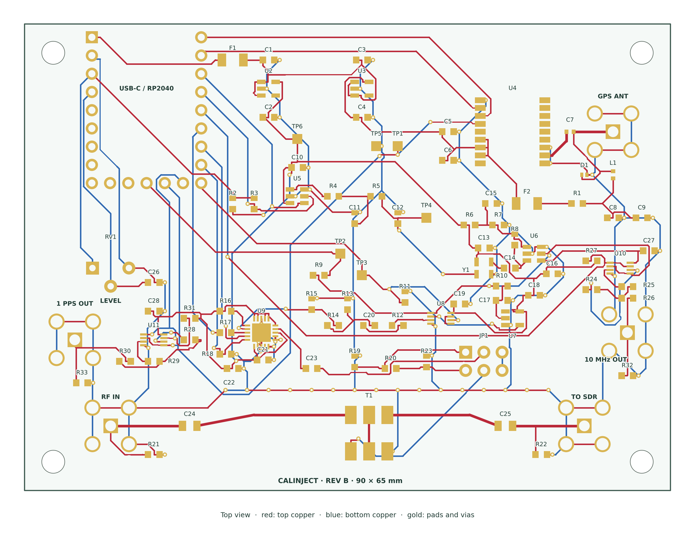

# Calinject

A small USB-C powered board that adds GPS-timed calibration bursts to an SDR recording. Use the bursts to measure sample timing, sample rate and frequency drift.

**Prototype, not yet built or tested on hardware.** This figure shows the current Rev A board, including its original directional coupler. The cheaper transformer-combiner replacement is still being worked out.

What it does:

- Generates a 10 MHz harmonic comb for HF and VHF receivers through 70 MHz.
- Sends a short calibration burst each second: **100 µs by default**, adjustable over USB.
- Lets you adjust the calibration level over USB or with a trimmer.
- Provides separate **10 MHz** and **1 PPS** SMA reference outputs.
- Reports GPS and frequency-servo status over USB. Firmware updates also use USB.

Connect it **after your antenna bias board and before the SDR**, with a separate active GPS antenna and USB-C power. The receiver ports block DC; disable the SDR's own bias tee. See the [connector guide](docs/port-guide.pdf).

The aim is **five factory-assembled boards**, with no user soldering or winding. The under-$100-per-board target is **not yet confirmed**; the current coupler version has about $87 in estimated parts alone. The first assembled board needs RF and timing tests before building the rest.

[Download all files](https://github.com/jvierine/calinject/releases) · [Connect and control](docs/operation.md) · [USB programming](firmware/README.md) · [Using the calibration](host/README.md) · [Print the case](mechanical/README.md)

Technical details: [design](docs/design.md), [review](docs/review.md), [cost](docs/cost.md), [KiCad/build instructions](docs/build.md), [factory assembly](manufacturing/ASSEMBLY.md), [acceptance tests](docs/acceptance.md), and [SVG board drawing](docs/board-layout.svg).
