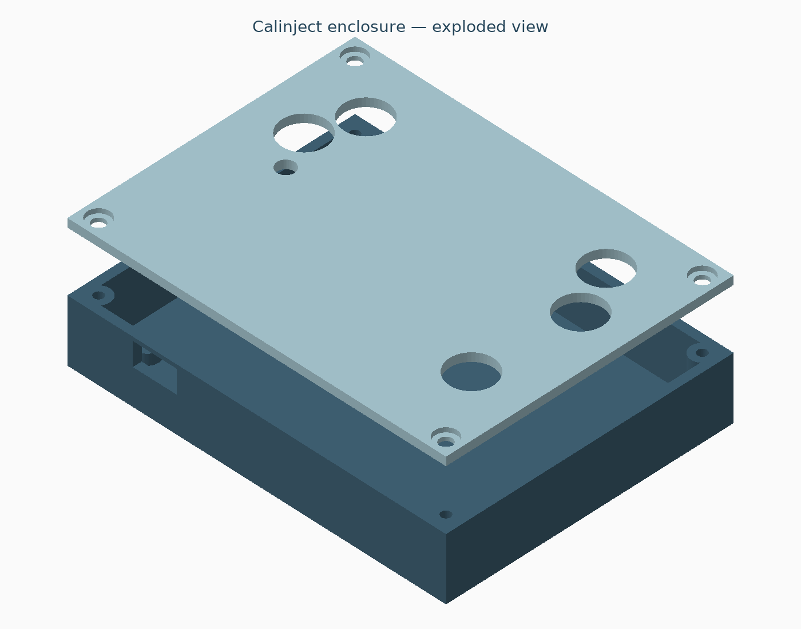

# Calinject

USB-C powered, GPS-timed RF calibration injector for SDR receivers. Rev A is an **unbuilt engineering prototype**. The fabrication files are generated and checked; RF performance and timing accuracy have not been measured.

The design provides a 10 MHz harmonic comb, normally gated for **100 microseconds per second**. USB serial controls the burst width (1–900,000 µs), continuous/mute modes, and attenuation. It also reports GNSS time validity, oscillator counts, frequency-servo state and DAC setting. A 3.3 V active GPS antenna connects to its own SMA.

Separate **10 MHz OUT** and **1 PPS OUT** SMAs provide buffered references. The 10 MHz is a continuous square wave; PPS follows the GNSS rising edge with a 10 ms pulse. Each output has approximately 50 Ω source impedance, nominal 3.3 V into high impedance or 1.65 V into 50 Ω. Both default disabled and can be enabled independently over USB. Check the receiving instrument's input level and waveform requirements. The 10 MHz phase is not locked to PPS. See [reference outputs](docs/design.md#reference-outputs).

## Connections

```text
Receiving antenna → existing bias board → RF IN [Calinject] TO SDR → receiver
                                             GPS ANT ← active GPS antenna
                                             USB-C   ← computer
```

The RF path blocks DC at both SMA ports. Keep the existing antenna bias board on the antenna side. Disable the SDR's own bias tee. The calibrator's GPS antenna has a separate, protected 3.3 V supply.

For an external combiner:

```text
50 Ω terminator → RF IN [Calinject] TO SDR → combiner calibration input
Receiving antenna / bias board ────────────→ combiner antenna input → SDR
```

Terminate RF IN; do not leave it open. Include the external combiner's insertion loss in the measured output-level calibration.

The coupler preferentially injects toward the SDR. It does not provide perfect antenna isolation. Receiver mismatch reflects some calibration energy back toward the antenna. See [RF and timing design](docs/design.md).

## Files


[Scalable SVG layout](docs/board-layout.svg). The illustration uses the actual routed Rev A board, with internal ground planes hidden for clarity. It still includes the original directional coupler; the proposed cheaper combiner revision has not been implemented.

- [KiCad project](cad/calinject.kicad_pro), editable schematic, PCB and local libraries in `cad/`.
- [Schematic PDF](docs/schematic.pdf), [assembly drawing](docs/assembly-top.pdf).
- [Connector/case guide](docs/port-guide.pdf), including both dedicated reference outputs.
- [Fabrication ZIP](manufacturing/calinject-revA-gerbers.zip), BOM and placement workbooks in `manufacturing/`.
- [Factory assembly instructions](manufacturing/ASSEMBLY.md) and [acceptance tests](docs/acceptance.md).
- MicroPython firmware in `firmware/`; USB logger and offline calibration tools in `host/`.
- Bambu Studio compatible [base](mechanical/base.3mf) and [lid](mechanical/lid.3mf), also STL and parametric enclosure source in `mechanical/`.
- Machine-readable verification reports in `validation/`.

## Intended manufacture

Request **PCBWay full turnkey assembly**, including all SMT parts, through-hole SMA connectors, trimmer, headers, controller module, jumper shunts, firmware loading and acceptance testing. No winding or soldering is assigned to the end user. PCBWay's procurement/assembly quote and DFM review are still required. Gerbers can also be fabricated by JLCPCB; assembly of the complete BOM through JLC has not been confirmed.

The cost target is under US$100 per assembled unit for **five boards**. Parts are estimated at about $87 per board, so this target is unlikely once assembly and qualification are included. [Cost assumptions](docs/cost.md) separate parts, assembly, testing and shipping; no supplier quotation has been obtained.

## Operating software

Install the dependencies with your preferred environment. In the author's workspace, Python commands use the base conda environment:

```bash
conda run -n base python -m pip install -r requirements.txt
conda run -n base python host/calinject.py /dev/ttyACM0 --send '{"cmd":"status"}'
conda run -n base python host/calinject.py /dev/ttyACM0 --send '{"cmd":"atten","db":31.5}'
conda run -n base python host/calinject.py /dev/ttyACM0 --send '{"cmd":"width","us":100}'
conda run -n base python host/calinject.py /dev/ttyACM0 --log status.h5
```

On macOS use the actual `/dev/cu.usbmodem...` device. One program owns the USB serial port at a time. See [firmware and commands](firmware/README.md) and [SDR calibration](host/README.md).

The oscillator is frequency disciplined to GPS over 64-second count windows. It is not a phase-locked laboratory reference. Sample rate, RF frequency and timing estimates retain finite uncertainty. The 0.1–1 µs timing goal requires measured cable/receiver delays, adequate received bandwidth/SNR, and confirmation that the recording has no dropped samples.

## Rebuilding and verification

Open the project in KiCad 10. `tools/export.py` validates and exports the frozen PCB without rerouting. `tools/design.py` and the other CAD generators are development tools; regenerating the PCB discards routing. See [build details](docs/build.md).

```bash
conda run -n base python -m unittest discover -s tests -v
conda run -n base python tools/export.py
conda run -n base python mechanical/enclosure.py
```

Software test success and KiCad rule checks do not establish measured hardware performance. Complete the first-article tests before authorizing a production batch.


