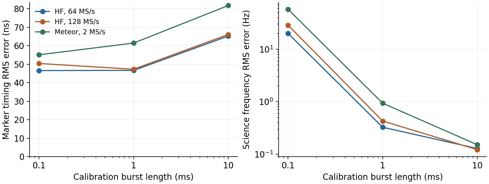

# Calinject

GPS-timed calibration bursts for SDR recordings: recover sample timing, estimate sample rate, and track frequency drift.

- **10 MHz harmonic comb**, with calibration harmonics through 70 MHz.
- **100 µs bursts by default**; pulse length and level adjustable over USB.
- Separate **10 MHz and 1 PPS SMA outputs**.
- **USB-C power**, firmware loading and status. Runs without a computer after programming; saved settings restore at startup.
- Four-layer, 90 × 65 mm PCB and a printable case with horizontal SMA ports.

Connect **antenna bias board → RF IN → TO SDR → receiver**. Add an active GPS antenna and 5 V USB-C power. The receiver path blocks DC and is specified for **0.5–70 MHz**, with about **3.2 dB loss**. Calibration leakage toward the antenna is finite; it must be measured on the first board.

Parts and board cost about **$80 per unit in small quantities**.

**Simulation, not measured performance:** longer bursts improve frequency estimation in the modeled receivers. Timing assumes known fixed delays and correctly associated UTC seconds. [Figures and assumptions](docs/figures.md).

[Download files](https://github.com/jvierine/calinject/releases) · [USB programming](firmware/README.md) · [Controls and LED](docs/operation.md) · [Print the case](mechanical/README.md) · [Hardware acceptance](docs/acceptance.md)

[Design](docs/design.md) · [Simulation details](docs/end-to-end.md) · [CAD/build](docs/build.md) · [Assembly](manufacturing/ASSEMBLY.md) · [Cost](docs/cost.md)
