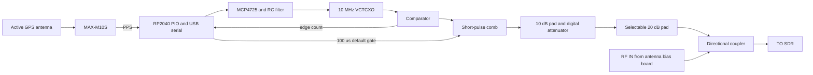
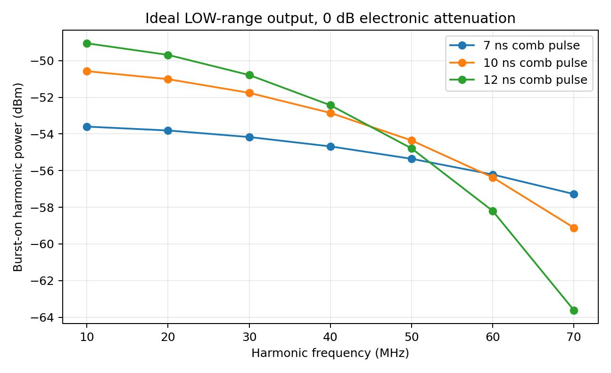

# RF and timing design

Rev A is an unbuilt prototype for a batch of five fully assembled boards. The retained coupler is the factory-built Mini-Circuits PDC-20-3+. No custom winding is required. Its specified band starts at 200 kHz; the board does not pass DC and performance below 200 kHz is not claimed. The intended qualified signal-path band is 0.2–70 MHz, subject to first-article measurement.

## Reference and timing

The ECS tunable, temperature-compensated oscillator supplies 10 MHz. The MCP4725 adjusts its control voltage through two RC sections. The RP2040 counts oscillator edges between GPS PPS edges and applies a slow frequency correction every 64 seconds. This is a frequency servo, not a phase-locked reference. The nominal DAC step corresponds to approximately 0.081 Hz at 10 MHz; the actual pull slope must be measured. The nominal 64-second counting resolution is 1/64 Hz, before GPS jitter and oscillator fluctuations.

The MAX-M10S provides a separate 10 ms logic PPS. The RP2040 PIO converts that edge to the requested RF gate width, default 100 µs. Width is adjustable from 1 to 900,000 µs; explicit continuous and mute modes are available. Software/USB scheduling does not set the gate edge. The first RF comb pulse can occur up to one 100 ns oscillator cycle after the gate opens. Receiver filtering, cable delays and GPS antenna delay must also be calibrated.

## Reference outputs

J4 provides the comparator's continuous 10 MHz square wave. J5 provides the GNSS logic PPS directly, with a 10 ms high pulse. Both are DC coupled, separately buffered and independent of the injection burst width and attenuation. Two SN74LVC2G125 packages isolate external loads: each uses its two channels through separate 49.9 Ω ballast resistors, followed by a common 24.9 Ω resistor. Nominal source resistance is 49.85 Ω plus driver impedance. Outputs are never directly tied together.

Expected output levels are about 3.3 V high into high impedance, or 1.65 V high into a matched 50 Ω load, with a near-zero low. The load divides the voltage; a 50 Ω input requiring a 2 V TTL high is **not compatible without a suitable external driver**. A 10 MHz sine-wave-only reference input needs a filter or a different output stage. Confirm the instrument's allowed waveform, DC coupling and amplitude. These are nominal values requiring measurement, not guaranteed calibrated levels.

Each SMA drives one receiver input/cable; use a reference distribution amplifier for several loads. Do not connect another signal source or DC bias to either output. A 1 MΩ resistor discharges the connector when the buffer is disabled; disabled does not mean a terminated 50 Ω port.

USB commands `ref10` and `refpps` enable the outputs independently. Both start disabled, and reset/watchdog disables them. Enable changes are asynchronous and may produce a shortened first/last pulse: enable before acquisition and discard the transition. While enabled, PPS follows the GNSS hardware output even if UTC validity is lost, and 10 MHz continues during oscillator holdover. Use the USB validity/servo status to decide when the references are trustworthy. Neither output is synthesized by Python scheduling.

The 10 MHz servo regulates average frequency; it does not align clock phase to PPS. Loading/cable delay of each buffered output must be characterized separately. Continuous reference output can increase pickup in a sensitive receiver even when the injection gate is muted, so disable unused references and qualify leakage with the actual cables connected.

The u-blox component timing specification is not the assembled board's timing accuracy. The requested 0.1–1 µs sample-time accuracy remains a system qualification target. Integer-second association must be established explicitly: identical 1 Hz bursts do not encode the UTC date or second. See the host instructions for resolving this ambiguity, clock drift and sample discontinuities.

## Harmonics and level

A delayed inverted clock ANDed with the original clock produces a short pulse each 100 ns. A 50%-duty square wave would suppress even harmonics; this short-pulse arrangement supplies both even and odd harmonics. The RC/logic pulse width is nominally about 7–12 ns and must be measured across supply and temperature. No arbitrary-frequency synthesizer is included. Changing the reference frequency would require hardware/firmware requalification.

The following are **ideal estimates**, not calibrated output specifications. For a 10 ns, 1.65 V loaded pulse, a 10 dB fixed pad, 1.3 dB attenuator insertion loss and 19.5 dB coupler loss:

| Setting | 10 MHz harmonic | 70 MHz harmonic |
|---|---:|---:|
| HIGH, 0 dB electronic attenuation | about −31 dBm | about −39 dBm |
| LOW, 0 dB electronic attenuation | about −51 dBm | about −59 dBm |
| LOW, 31.5 dB electronic attenuation | about −82 dBm | about −91 dBm |

These are burst-on power per harmonic in a matched 50 Ω load. The other harmonics lie between these nominal endpoints for the assumed pulse shape. Actual driver impedance, pulse shape, PCB coupling and component losses change the values. The electronic range is 0–31.5 dB in 0.5 dB steps. Two internal shunts select an additional 20 dB. The factory ships LOW with maximum electronic attenuation. The front-access trimmer can control attenuation when enabled over USB.

The plotted ideal model shows why comb pulse width must be measured, especially at the seventh harmonic. Its numeric values are supplied in `validation/ideal-levels.h5`.

At 100 µs once per second, duty factor is 0.0001. Time-averaged power integrated over a burst's spectral sidebands is 40 dB below burst-on power. Individual resolved 1 Hz spectral teeth have different scaling; do not confuse a long FFT bin with integrated harmonic-band power. Gating intentionally creates sidebands, and the comb also extends above 70 MHz. Use the receiver's front-end filtering and measure off-state leakage. This is not a spurious-free signal generator.

## Directionality

The coupler's package INPUT goes to the SDR and OUTPUT to the antenna. Reciprocity sends energy injected at its forward-coupled port toward INPUT. Its internal factory transformer construction provides broadband operation without user winding.

Finite directivity leaves some calibration at RF IN even with matched ports. More importantly, calibration reflected by a mismatched SDR travels back through the main line toward the antenna. For example, 10 dB receiver return loss can produce a returned signal only about 10 dB below the incident calibration, regardless of better intrinsic coupler directivity. The board cannot guarantee zero radiation into the antenna. Measure the actual powered receiver interface; adding a pad improves matching at the cost of receiver sensitivity.

For standalone generator use, terminate RF IN in 50 Ω and connect TO SDR to the external combiner. The output levels above then refer to TO SDR, before the external combiner's loss.

## Physical design

The board is 90 × 65 mm, four layers, with two internal ground planes. GPS RF routing is short on the top layer. The nominal stack uses 0.20 mm outer dielectrics and 0.36 mm RF traces; the fabricator must confirm the actual impedance and stack. The remaining 10–70 MHz network is compact but still requires RF measurement. Digital clock and USB leakage can bypass the logical gate, particularly in the unshielded printed case.

The RP2040-Zero is a purchased module installed and soldered by the factory. USB-C termination, USB circuitry and MCU clock are on that module. Separate linear regulators supply the GNSS and RF/reference sections. The GPS SMA provides protected 3.3 V bias for an active antenna drawing at most 20 mA normally. RF IN and TO SDR are separately DC blocked; they do not carry antenna bias through the board.

Component documents and pricing references are listed in [sources](sources.md). Electrical-rule checks test connectivity/rules; they do not verify these physical performance assumptions.
