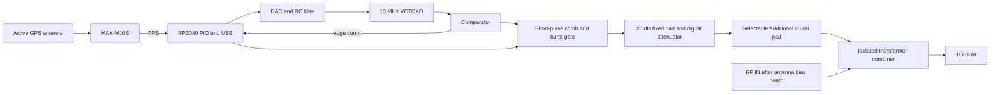

# Rev C RF and timing design

Rev C uses an ADP-2-1+ SMT transformer combiner, with a specified signal-path band of **0.5–70 MHz** and approximately **3.2 dB receive-path loss**. No user winding or soldering is required. Its horizontal SMAs exit the case walls. The KDS tunable TCXO, active TI DCT output buffers, Nexperia AND gate and standard headers replace the sourcing bottlenecks in Rev B. See [parts selection](sourcing.md). Operation below 500 kHz is not specified.

## Reference and burst timing

The KDS 1XTV10000MDA tunable TCXO supplies 10 MHz; a comparator converts its clipped sine to logic. The MCP4725 adjusts its control voltage through two RC sections. RP2040 PIO counts oscillator edges between GPS PPS edges; a slow frequency servo corrects the DAC every 64 seconds. Nominal counting resolution is 1/64 Hz at 10 MHz, before GPS/oscillator fluctuations. This controls average frequency and does not phase-lock 10 MHz to PPS. The positive tuning slope must be calibrated; KDS specifies ±8–15 ppm pull over 0.5–2.5 V and at least 500 kΩ control input. Top/Inner1 copper keepouts implement the manufacturer's bottom-clearance requirement.

GPS generates a 10 ms logic PPS. Another PIO state machine generates the requested injection gate, default 100 µs. Width is adjustable from 1 to 900,000 µs, with separate continuous/mute modes. A descriptor authorizes one burst; software starvation cannot create repeated autonomous bursts. The first comb pulse is quantized by up to one 100 ns clock period after the gate. Host scheduling does not set the gate edge.

The 0.1–1 µs end-to-end sample timing target requires measured antenna/cable, board and receiver/filter delays, adequate bandwidth/SNR, and a capture without unaccounted sample loss. Identical 1 Hz RF bursts do not encode the UTC date/second: associate them with logged GPS epochs and a known starting second or identifiable gap. See the host workflow.

## Harmonics and adjustable level

R10/C17 and U7/U8 make nominal 7–12 ns pulses every 100 ns. Short pulses provide even and odd harmonics, unlike a 50%-duty square wave. The physical pulse width and harmonic envelope must be measured on the first article across supply/temperature. The ideal model is a design estimate, not a measured guarantee. No arbitrary-frequency synthesizer is included.

Rev B increases the fixed pad to 20 dB using 61.9 Ω shunts and a 249 Ω series resistor. The PE4312 adds 0–31.5 dB electronic attenuation in 0.5 dB steps. Both internal range shunts select an additional 20 dB in LOW or bypass it in HIGH. The factory ships LOW with maximum electronic attenuation.

Assuming a 10 ns rectangular pulse of 1.65 V loaded peak, 20 dB fixed loss, 1.3 dB PE4312 insertion loss and 3.2 dB combiner loss, nominal burst-on powers at TO SDR are:

| Setting | 10 MHz | 70 MHz |
|---|---:|---:|
| HIGH, 0 dB electronic attenuation | −24 dBm | −33 dBm |
| LOW, 0 dB electronic attenuation | −44 dBm | −53 dBm |
| LOW, 31.5 dB electronic attenuation | −76 dBm | −84 dBm |

These are per-harmonic estimates into 50 Ω. Driver impedance, pulse width and actual component losses change them. At 100 µs per second, time-averaged power integrated over the burst sidebands is 40 dB below burst-on power. Individual resolved 1 Hz FFT teeth have different scaling. Gating creates sidebands; the comb also extends above 70 MHz, so receiver anti-alias filtering remains necessary.

Numeric ideal model data are in `validation/ideal-levels.h5`.

## Antenna leakage and matching

T1 sum pin1 goes to SDR; branch3 takes the antenna and branch4 takes calibration. Pins2/5 join together but remain isolated from ground. The chosen component's minimum branch isolation is 20 dB; typical data are about 30–34 dB at 10–60 MHz. With a matched SDR, that typical leakage is about 27–31 dB below the level reaching the SDR, after allowing for its approximately 3.2 dB combiner loss. Thus −70 dBm per harmonic at SDR corresponds to a typical −97 to −101 dBm toward the antenna. This is not a guaranteed board result; minimum isolation is less favorable.

A receiver mismatch adds reflected leakage through the sum port. Keep the matched receiver assumption explicit and measure the actual powered system. The board cannot guarantee zero antenna radiation. Standalone source use remains supported: terminate RF IN in 50 Ω and use TO SDR as the source output to another combiner, accounting for its additional loss.

## Reference outputs

J4 provides the continuous comparator-derived 10 MHz square wave; J5 provides the GNSS 10 ms PPS. They are independent of injection width and attenuation. Each output uses an SN74LVC2G125's two channels, each through 100 Ω, followed by a common zero-ohm link. The individual ballast resistors prevent direct tying of CMOS outputs and share a 50 Ω load. Nominal source resistance is 50 Ω plus driver impedance.

Expected highs are about 3.3 V into high impedance or 1.65 V into 50 Ω, with a near-zero low. A 50 Ω input requiring a 2 V TTL high needs a different external driver; a sine-only clock input may need filtering. Drive one input/cable per output. Do not connect another signal source or DC bias. Disabled outputs have a 1 MΩ bleed and are not matched terminations.

USB enables the outputs separately. Hardware pullups disable them during reset; explicitly saved settings can restore enables after boot. Enable before acquisition because asynchronous enable transitions may shorten the first/last pulse. Enabled PPS follows GNSS even when UTC is invalid; enabled 10 MHz continues in holdover. Use reported validity/servo state. There is no fixed 10 MHz phase relative to PPS.

## Layout and manufacture

The 90 × 65 mm board has four layers, two inner ground planes and ordinary plated through vias. Rev B compacts the weak oscillator/comparator section, moves bypass capacitors closer to the comb/attenuator loads, and adds ground stitching between clock circuitry and the receiver path. SMD pads use only F.Cu/F.Mask/F.Paste; body/courtyard geometry follows footprint rotation.

The nominal stack uses 0.20 mm outer dielectrics and 0.36 mm RF traces. The fabricator must confirm actual materials, pressed thickness and impedance, especially the 1.575 GHz GPS path. Digital leakage can bypass the gate/attenuator despite these layout improvements; measure muted spectra with USB and reference cables connected. The printed case is not an RF shield.

The factory installs and programs the RP2040-Zero module and all THT parts. Separate regulators power GPS and reference/RF circuitry. GPS ANT supplies protected 3.3 V bias for a compatible antenna normally drawing at most 20 mA. The receiver ports are DC blocked; keep the existing antenna bias board ahead of RF IN and disable the SDR bias tee. See [factory instructions](../manufacturing/ASSEMBLY.md), [acceptance tests](acceptance.md) and [sources](sources.md).

For the cable-driver, decoupling, power-isolation and ground-stitching audit, see [layout review](layout-review.md).
