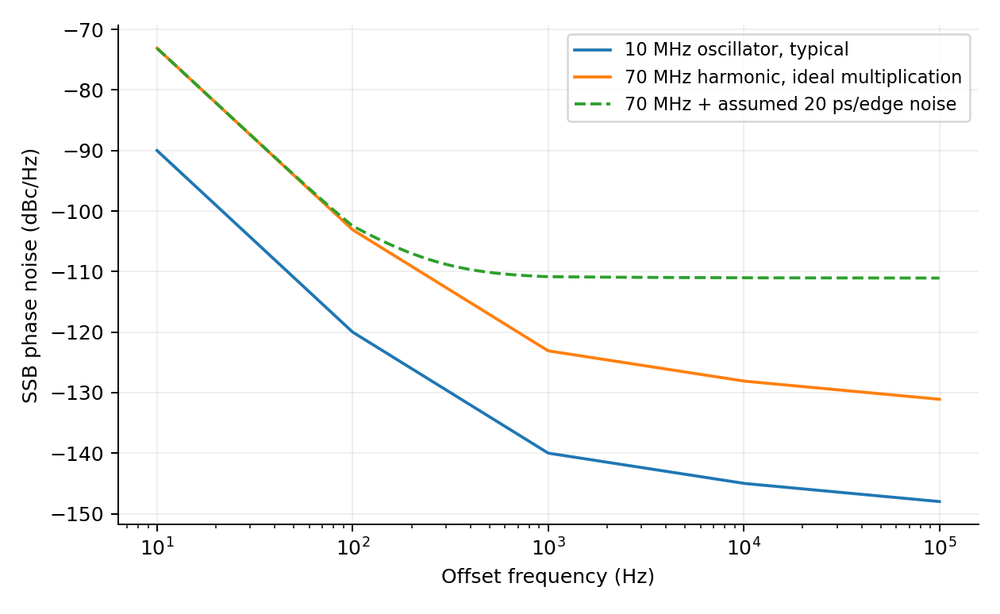
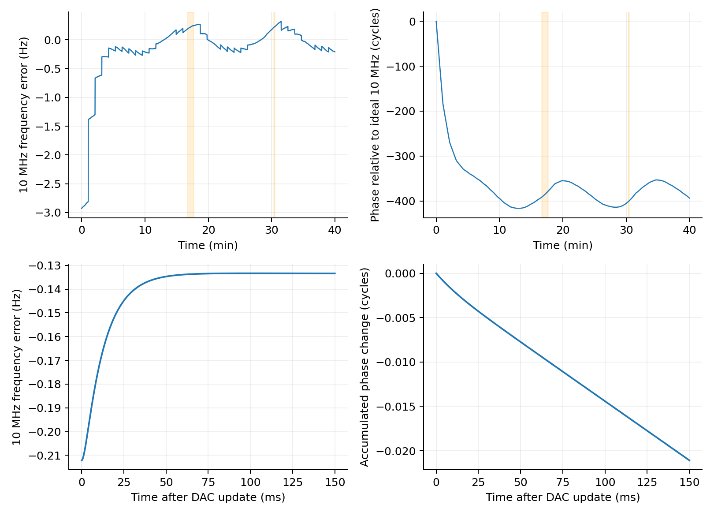
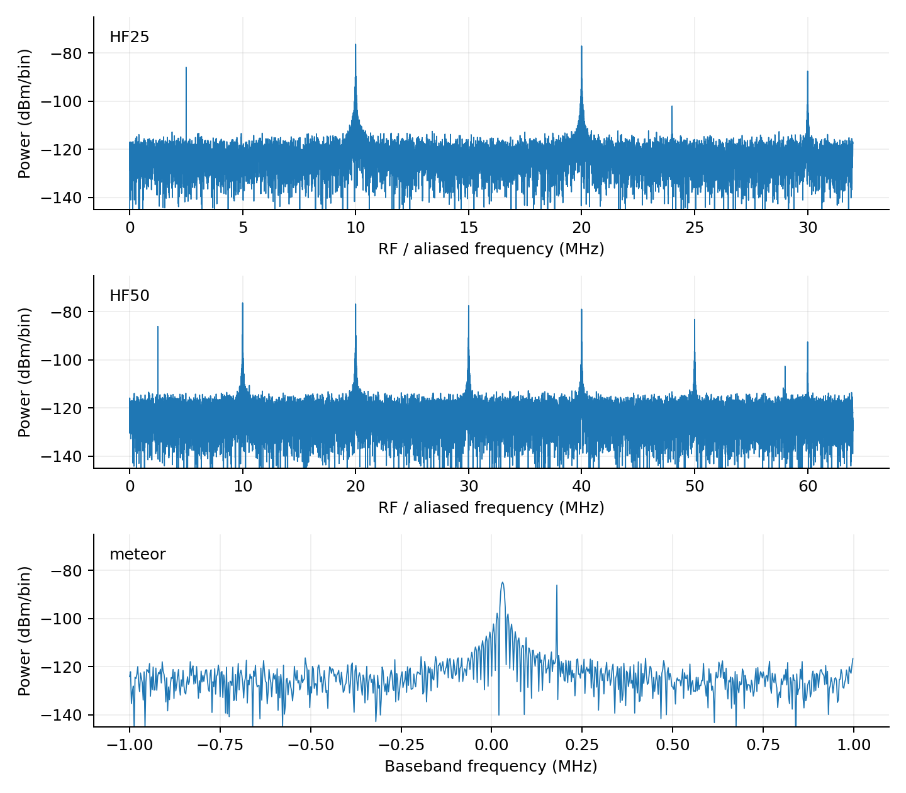

# End-to-end behavioral simulation

The simulation now connects GPS/PPS events, the actual frequency servo, loaded DAC filtering, continuous oscillator phase, harmonic phase noise, adjustable injection level, generic receiver filtering, ADC-clock drift and quantization, marker detection, sample-rate fitting, and science-frequency recovery. It also tests an offline reference tracker and applies a phase-continuous correction to synthetic IQ. **These are modeled results, not measured board or receiver performance.**

## USB controls and steering

Already supported: electronic attenuation 0–31.5 dB in 0.5 dB steps, burst length 1–900,000 µs, mute/burst/continuous modes, servo enable, manual DAC code, slope calibration, status and explicit settings save. The dedicated PPS SMA stays at its configured 10 ms GNSS width; `width` changes the RF burst. The physical LOW/HIGH range shunts add/bypass another 20 dB; USB does not move those shunts. Example JSON commands:

```json
{"cmd":"atten","db":20}
{"cmd":"width","us":1000}
{"cmd":"save"}
```

The hardware oscillator is never phase-reset by these commands. The existing servo updates a DAC target every 64 valid seconds; the two RC sections turn that voltage change into a frequency ramp. Phase remains the integral of frequency. There is no programmable firmware slew-rate command in this release. Supply feedthrough, DAC glitches, and comparator threshold changes could still perturb real phase and need measurement. A manual DAC command disables the automatic servo.

## Phase-noise budget

The [ECS datasheet](https://ecsxtal.com/store/pdf/ECS-TXO32-S3.pdf) specifies these oscillator phase-noise points at 10 MHz. They apply to a continuous carrier; burst gating adds deterministic sidebands and must not be mistaken for oscillator phase noise.

| Offset | Typical at 10 MHz | Maximum column at 10 MHz | Ideal typical at 70 MHz |
|---|---:|---:|---:|
| 10 Hz | -90 dBc/Hz | -85 dBc/Hz | -73.1 dBc/Hz |
| 100 Hz | -120 dBc/Hz | -115 dBc/Hz | -103.1 dBc/Hz |
| 1000 Hz | -140 dBc/Hz | -135 dBc/Hz | -123.1 dBc/Hz |
| 10000 Hz | -145 dBc/Hz | -140 dBc/Hz | -128.1 dBc/Hz |
| 100000 Hz | -148 dBc/Hz | -143 dBc/Hz | -131.1 dBc/Hz |

The nth harmonic multiplies phase fluctuations by n: phase-noise power rises by 20 log10(n), while the corresponding time jitter is unchanged. Comparator, logic, supply and buffer noise add to that. The model sweeps assumed 20 and 100 ps independent per-edge noise; neither is a guaranteed board jitter value. The time/phase relation uses Sφ(f) = 2 × 10^(L(f)/10) for the one-sided phase PSD.



Log-log interpolation of the published points gives 1.63 ps typical and 2.90 ps using the maximum column, integrated only from 10 Hz to 100 kHz. These are interpolation calculations, not an integrated-jitter guarantee. Noise below 10 Hz, above 100 kHz and additive board noise are not bounded by those figures.

## What software tracking gains

The onboard loop keeps the oscillator near 10 MHz; it does not phase-lock it to PPS. In this run the slow thermal perturbation and 64 s updates leave a larger reference error than the earlier ideal white-noise-only test. The software observer uses the integer GPS edge counts and logged DAC targets, reconstructs the loaded RC response, then fits residual phase over a centered 64 s window. It does not use the true oscillator frequency to form its estimate.

The centered fit needs future data: it is an offline smoother, not a zero-latency real-time tracker. UTC correspondence must already be resolved. A live predictor would have a different error/latency budget. The observer is a simulation prototype rather than an automatic production capture pipeline.

For the 70 MHz meteor case, 20 dB electronic attenuation:

| Burst | Marker RMS error | Science frequency RMS before reference tracking | After reference tracking |
|---|---:|---:|---:|
| 0.1 ms | 47 ns | 61.8 Hz | 61.7 Hz |
| 1 ms | 63 ns | 1.93 Hz | 0.871 Hz |
| 10 ms | 81 ns | 1.66 Hz | 0.143 Hz |

The reference-frequency estimate itself has 0.0033 Hz RMS error at 10 MHz in that modeled interval. Multiplying it by seven supplies the estimated actual 70 MHz pilot frequency for science-frequency recovery. Results include ±10% assumed tuning-gain sensitivity for this scenario; they do not bound arbitrary thermal histories, supply noise or tuning nonlinearity.

`host/tracking.py` integrates a piecewise-linear frequency track analytically, producing continuous phase and frequency at every knot. It never unwraps carrier phase across the 1 s gaps. The paired validation applies this correction to actual synthetic IQ using estimated sample times, then remeasures the science tone. Tests also check a chirp across knot boundaries. Continuous interpolation does not recover unobserved integer-cycle ambiguities or establish absolute carrier-phase coherence between bursts. The coherent frequency estimator avoids the isolated phase-unwrapping failures seen in the earlier averaging sweep, but still needs a properly isolated pilot and can select a strong interferer.



Orange intervals indicate modeled GPS-invalid periods. DAC updates change frequency smoothly through the RC response; the phase curve is not steered back to zero.

## Receiver and signal assumptions

Three cases are simulated: direct-sampled HF with 64 MS/s and a 10 MHz pilot; direct-sampled wider HF with 128 MS/s and a 40 MHz pilot; and a 2 MS/s tuned meteor receiver containing the 70 MHz pilot. Each is analyzed in an equivalent 1 MS/s complex channel. These are RX888-like/RTL-like configurations, not calibrated hardware models. A generic 350 kHz low-pass channel, assumed aperture jitter and gain, and equivalent 16/8-bit quantization are included.

The science signal is an isolated −86 dBm tone 150 kHz above the selected harmonic, measured for 10 ms outside the calibration burst. The pilot is recovered inside the burst after filter transients are trimmed. A training template and coarse acquisition frequency are assumed; the fine arrival and frequency are estimated from noisy data. The simulations use explicitly associated UTC epochs, not USB arrival timestamps. They do not resolve the integer-second ambiguity automatically.

The background is −96 dBm per 1 MHz equivalent channel before filtering. LOW range and electronic attenuation of 20 or 31.5 dB give different pilot SNRs at each harmonic. Pilot levels come from the ideal 10 ns pulse model, not a measured RF transfer function. Prior 7/10/12 ns pulse-width sensitivity, passive SPICE and cable-driver simulations remain separate checks linked from the simulation/layout reports.

The ADC clock starts 3 ppm fast and drifts by 0.002 ppm/s; the tuner LO starts 100 Hz off and drifts by 0.02 Hz/s. Generic tuner phase noise is explicitly assumed. The two-pole DAC filter includes the specified minimum 100 kΩ control-input load, giving a 0.9804 DC gain; commissioning must measure Hz/code at the actual oscillator. GPS jitter is assumed 20 ns RMS, PIO synchronization is quantized in 8 ns steps, and the first RF pulse has a 0–100 ns phase-dependent delay. Fixed path delay is assumed known and subtracted.

The core run has 23 cases: three receiver profiles × three widths × two attenuations, plus GPS loss, sample loss, overload, and two phase-noise sensitivities. Every normal case spans 64 possible PPS epochs, including a GPS-invalid interval. The paired check repeats sensitivity cases with identical random noise so parameter changes can be distinguished from Monte Carlo scatter. Numerical timing convergence is checked at 16×, 32× and 64× waveform oversampling.

## Discontinuities, overload and aliases

GPS-invalid epochs suppress bursts while the reference oscillator continues. This models invalid UTC flags before arming; antenna-loss detection latency and a burst already armed before a late fault remain hardware/firmware acceptance checks. A 4096-native-sample recording drop produces a large fit residual and is flagged: analysis must split at the discontinuity. The overload scenario is also flagged and excluded from usable results even if a frequency fit happens to look plausible. These flags describe the simulation analysis; actual recording software must inspect raw clipping and sample-loss metadata. One affine clock fit across the whole drift interval is insufficient; short-window rate fits are used for correction.

Native-rate real HF and complex meteor snapshots include twenty comb harmonics (through 200 MHz), carrier response of generic sixth-order anti-alias filters, broadband noise, a science tone and 16/8-bit quantizers. They demonstrate how harmonics outside Nyquist can fold into the recording. Actual RX888/RTL filter curves, ENOB, nonlinearity and out-of-band response must be measured. Analogue gate/filter transients in these broadband snapshots are simplified to per-carrier responses. The main marker model uses a time-domain receiver filter.



The RF comb is not bandlimited to 70 MHz. Harmonics above 200 MHz are omitted from these snapshots. The injected spectrum and the receiver anti-alias path both need bench checks.

## Antenna leakage and other physical limits

The RF combiner is represented by nominal 3.2 dB forward loss; it is not an extracted three-port PCB/transformer model. With 20 dB branch isolation and a matched SDR, calibration leaking toward the antenna can be only 16.8 dB below the level delivered to the SDR. Receiver mismatch can make isolation worse. The separate layout review documents finite isolation, the shared quiet/fast-logic rail and lack of ferrite filtering. No simulation here establishes negligible radiation or muted clock feedthrough.

Unknowns still requiring first-article measurements include actual GNSS timing, DAC gain/nonlinearity/glitches, oscillator supply pushing, comparator/logic jitter, pulse width, harmonic levels, RF matching/isolation, board coupling, regulator stability, USB-induced spurs, cable delays, receiver group delay and gain, and real interference. There is no full transistor-level board, electromagnetic, GNSS RF, ARM firmware or USB-stack emulation. Actual UBX framing/UTC validity, the servo code and host estimators are reused; PIO/compiler, USB queue, cable-driver SPICE and CAD checks are additional independent validations.

## Reproduce and inspect

```sh
conda run -n base python tools/run_end_to_end.py
conda run -n base python -m unittest discover -s tests -v
```

HDF5 stores synthetic samples, marker positions, reference counts, DAC states, recovered frequencies, phase corrections, spectra and assumptions. JSON summaries accompany the arrays in `validation/end-to-end/`. These artifacts contain no bench data. [Earlier simulations](simulation.md) · [Averaging tradeoff](averaging.md) · [Layout and power review](layout-review.md) · [Hardware acceptance](acceptance.md).
