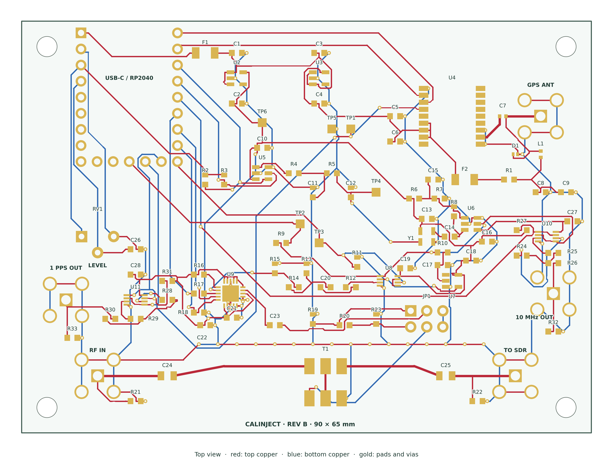
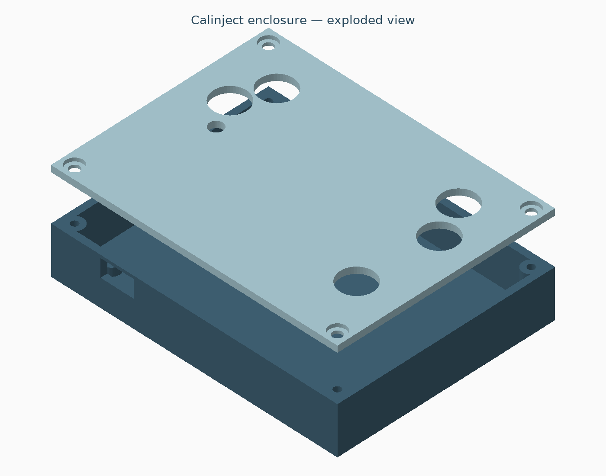
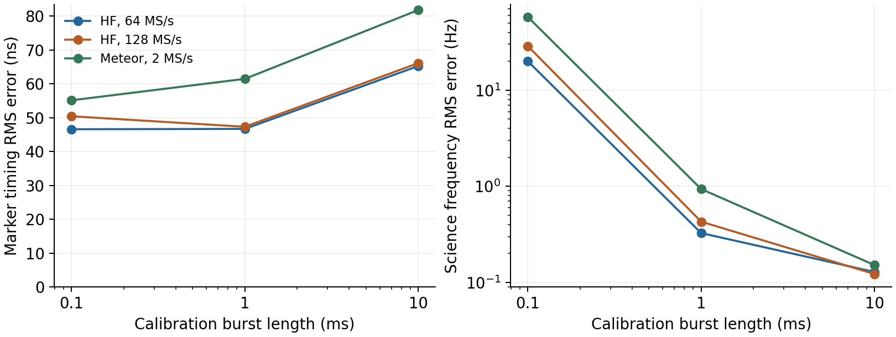
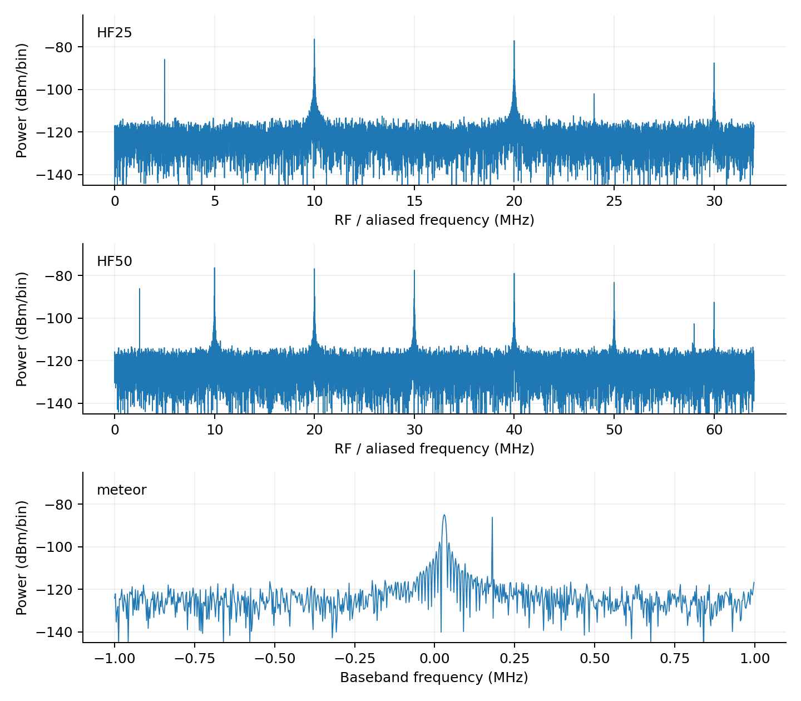

# Calinject figures

## Board and enclosure

The four-layer board has horizontal SMA connectors. The illustration shows top and bottom traces with the ground planes hidden. U1 is the USB-C RP2040-Zero module; U4 is the MAX-M10S GNSS receiver. The current U5 is MCP4725A1, with firmware support for its 0x62 I²C address.

The 98 × 73 × 20 mm case includes side openings for the five SMAs, USB-C access and an RGB status window. STL and 3MF geometry are supplied; physical fit awaits the first print. [Printing instructions](../mechanical/README.md).

## Burst length and recovery

Behavioral simulations at 20 dB electronic attenuation, LOW range. Each curve uses the same modeled receiver profile at 0.1, 1 and 10 ms burst widths. Frequency errors include the offline 64 s reference observer. HF25 uses a 64 MS/s real receiver and 10 MHz pilot, HF50 uses 128 MS/s and a 40 MHz pilot, and meteor uses a 2 MS/s complex receiver around a 70 MHz pilot. Analysis uses an equivalent 1 MS/s channel.

The timing calculation subtracts a known fixed delay and assumes correctly associated UTC seconds. Noise, phase noise, receiver filtering and oscillator drift are modeled assumptions. These curves are not accuracy specifications or hardware measurements. Longer pulses occupy more of the science recording: 0.01%, 0.1% and 1% duty cycle respectively at one burst per second.

## Spectrum examples

Synthetic native-rate HF and meteor recordings, including generic receiver filtering, noise, quantization and aliases. A narrow tuned recording must include a comb harmonic. The small isolated science tone is separate from the calibration comb. Actual injected levels, out-of-band response and receiver overload require bench tests.

[Full model and assumptions](end-to-end.md) · [Acceptance measurements](acceptance.md)
